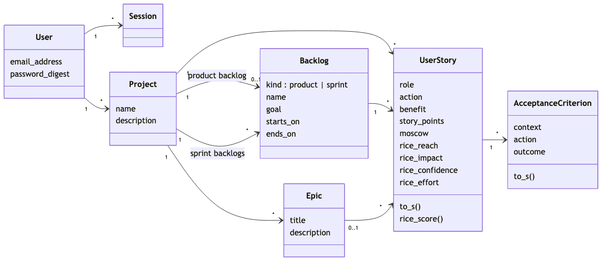
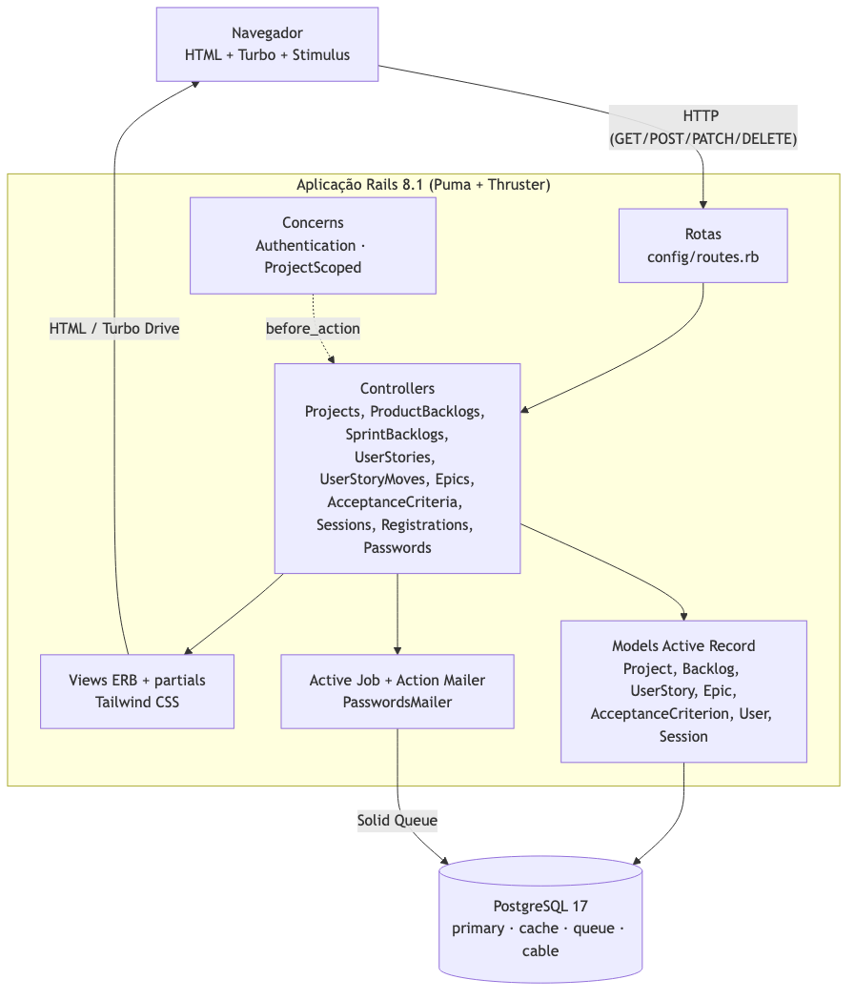
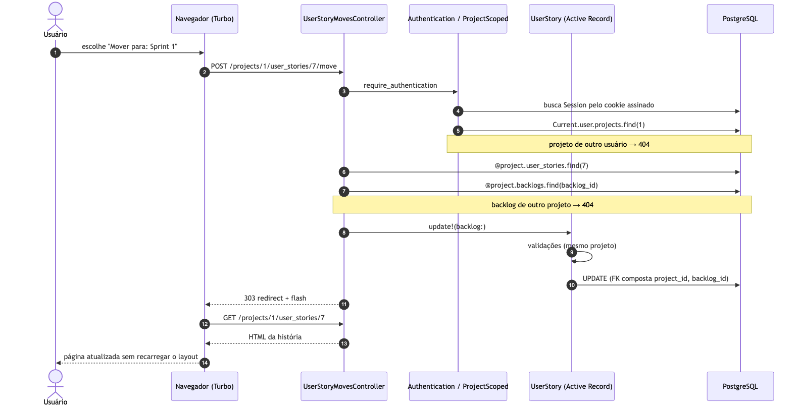
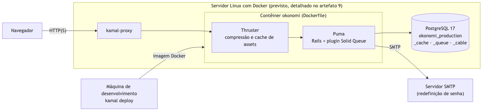

# okonomi — Architecture notebook

**Artefato 5** do Trabalho Prático de Engenharia de Software (2026.2): descrição da
arquitetura do software. Rastreado pela issue
[#29](https://github.com/WilsonSousajr/okonomi/issues/29); segue o modelo
`architecture-notebook.odt` (instrução 3), atende às instruções 15 e 16 e ao
Critério de Avaliação 05.

| Versão | Data | Autor | Descrição |
|---|---|---|---|
| 1.0 | 28/10/2026 | José Wilson Barbosa de Sousa Júnior | Versão inicial. |

## 1. Propósito

Este documento descreve a filosofia, as decisões, as restrições, os elementos
significativos e os mecanismos que dão forma ao okonomi, uma aplicação web para
gerenciar requisitos de software com histórias de usuário. Ele serve a quem vai
manter ou estender o sistema: explica **por que** o código está organizado como
está, e não só o que ele faz. O esquema do banco é detalhado à parte, no
[projeto físico do banco de dados](BANCO-DE-DADOS.md) (artefato 7), e o ambiente
de produção no artefato 9 ([#33](https://github.com/WilsonSousajr/okonomi/issues/33)).

## 2. Objetivos e filosofia da arquitetura

1. **Integridade do domínio acima de tudo.** As regras do enunciado (escala de
   story points, domínios do RICE, um único product backlog, movimentação só no
   mesmo projeto) valem mesmo que alguém contorne o formulário. Cada regra é
   imposta em duas camadas: validação no *model* e, quando o banco consegue
   impor, restrição no PostgreSQL.
2. **Simplicidade para uma pessoa manter.** O trabalho é individual e tem seis
   semanas. A arquitetura evita peças que exigem operação própria (SPA separada,
   Redis, fila externa, microsserviços).
3. **Convenção do framework em vez de configuração.** Seguir as convenções do Rails
   deixa o código previsível: dado um recurso, já se sabe onde ficam a rota, o
   *controller*, as *views* e os testes.
4. **Servidor como fonte da verdade.** O estado vive no servidor e o navegador
   recebe HTML. Não existe uma segunda cópia das regras em JavaScript para manter
   em sincronia.
5. **Privacidade por padrão.** Cada usuário enxerga apenas os próprios dados. O
   isolamento é estrutural (toda consulta parte do usuário atual), não uma
   verificação que pode ser esquecida.

## 3. Suposições e dependências

**Suposições**

- O sistema é usado por poucas pessoas ao mesmo tempo (uma equipe de produto e o
  professor avaliando). Não há requisito de escala horizontal.
- Cada projeto pertence a um único usuário. O enunciado não pede colaboração
  entre contas.
- O acesso é por navegador moderno, no computador ou no celular. Não há aplicativo
  nativo nem API pública.
- A interface é em português do Brasil.

**Dependências**

| Dependência | Versão | Papel na arquitetura |
|---|---|---|
| Ruby | 3.4.10 | Linguagem da aplicação. |
| Ruby on Rails | 8.1 | Framework MVC: rotas, *controllers*, *views*, Active Record, Active Job, Action Mailer. |
| PostgreSQL | 17 | Banco de dados único: dados do domínio, cache, fila de jobs e canais. |
| Hotwire (Turbo + Stimulus) | turbo-rails, stimulus-rails | Navegação e atualizações parciais sem SPA. |
| Tailwind CSS | v4 (tailwindcss-rails) | Estilo por classes utilitárias, compilado no servidor. |
| Importmap | importmap-rails | JavaScript sem *bundler* nem Node em produção. |
| Solid Cache, Solid Queue, Solid Cable | Rails 8 | Cache, jobs e websockets guardados no PostgreSQL. |
| bcrypt | 3.1 | Hash das senhas (`has_secure_password`). |
| Puma + Thruster | — | Servidor de aplicação e *proxy* HTTP na frente dele. |
| Kamal + Docker | — | Empacotamento e implantação (artefato 9). |
| Minitest, Capybara, Selenium | — | Testes de unidade, de integração e de sistema no Chrome. |

## 4. Requisitos arquiteturalmente significativos

Os requisitos abaixo moldaram a arquitetura. Os demais são atendidos dentro dela
sem exigir decisões novas. A lista completa está nos
[requisitos não funcionais](REQUISITOS-NAO-FUNCIONAIS.md) (artefato 3) e nas
[histórias de usuário](HISTORIAS-DE-USUARIO.md) (artefato 4).

| Requisito | Por que é significativo | Onde é atendido |
|---|---|---|
| RF05: no máximo um product backlog por projeto | Exige uma regra de unicidade **condicional**, só para `kind = 'product'`. | Validação em `Backlog` + índice único parcial (seção 5, D6). |
| RF08 e RF11: história só se move para backlog e só se vincula a épico do mesmo projeto | Uma chave estrangeira simples aceitaria um backlog de outro projeto. | Validação em `UserStory` + FKs compostas `(project_id, backlog_id)` e `(project_id, epic_id)`. |
| RF09 e RF13: formatos *Como um … eu quero … para …* e *Dado … quando … então …* | O formato não pode depender de texto livre. | Três colunas em cada tabela; o texto é montado por `to_s`. |
| RF15 e RF18: domínios fechados de story points e RICE | Valores fora do domínio não podem ser gravados nem por script. | Constantes em `UserStory` + restrições `CHECK` no banco. |
| RF19: RICE = (R × I × C) / E, com Effort = 0 | A fórmula precisa ser exata e não pode dividir por zero. | `rice_impact` em `decimal(3,2)`; `UserStory#rice_score` devolve `nil` (indefinido) quando falta um valor ou E = 0. |
| RF03 e invariante 8: cada usuário vê só os próprios dados | Um ID de outro usuário na URL não pode vazar nada. | Concern `ProjectScoped` e consultas por `Current.user` (seção 6.3). |
| RNF de usabilidade: responsivo e acessível | A interface tem que funcionar a partir de 375 px, com erros anunciados. | Layout único com Tailwind, mensagens com `role="alert"` e campos com `aria-invalid`. |

## 5. Decisões, restrições e justificativas

| # | Decisão | Justificativa | Alternativa descartada |
|---|---|---|---|
| D1 | **Monólito Rails MVC**, uma única aplicação. | Uma pessoa, seis semanas, um domínio pequeno. O MVC do Rails já separa responsabilidades sem custo de integração. | Backend de API + SPA: duas bases de código, duas implantações, regras duplicadas. |
| D2 | **Hotwire em vez de SPA.** O servidor renderiza HTML; o Turbo Drive troca o `<body>` sem recarregar a página. | Mantém o estado e as regras num só lugar (servidor) e entrega a fluidez de uma SPA com quase nenhum JavaScript próprio. | React/Vue: exigiria API JSON, *bundler* e validação repetida no cliente. |
| D3 | **Regras de domínio no Active Record, repetidas no banco.** | O *model* dá mensagens claras ao usuário; o banco garante a regra mesmo fora da aplicação (console, script, defeito). | Só validação no *model*: um `update_columns` ou um SQL manual passariam por cima. |
| D4 | **PostgreSQL como único serviço de dados.** Cache, fila e websockets usam Solid Cache, Solid Queue e Solid Cable. | Um só serviço para instalar, copiar e monitorar. O volume de jobs (e-mail de senha) é mínimo. | Redis + Sidekiq: mais um serviço sem ganho real nessa escala. |
| D5 | **PostgreSQL em vez de SQLite.** | O domínio precisa de índice único parcial, FKs compostas, `CHECK` e `decimal` exato, todos maduros no PostgreSQL. | SQLite: mais simples de rodar, mas mais fraco em restrições compostas e concorrência de escrita. |
| D6 | **Índice único parcial** `backlogs(project_id) WHERE kind = 'product'`. | Expressa exatamente "no máximo um product backlog" sem limitar sprints. | Coluna `product_backlog_id` em `projects`: separaria o product backlog das sprints e complicaria a movimentação. |
| D7 | **Um único modelo `Backlog` com `kind`** (`product` / `sprint`). | Mover uma história é trocar um `backlog_id`, sem copiar dados (RF08). | Tabelas separadas para product e sprint: mover exigiria apagar e recriar. |
| D8 | **`rice_impact` em `decimal(3,2)` e Confidence como inteiro percentual.** | O domínio é um conjunto fechado comparado por igualdade (`inclusion` e `CHECK … IN`). `decimal` guarda exatamente o valor escolhido, e a fórmula usa `C / 100.0`. | `float`: a maioria dos decimais não tem representação binária exata, e comparar por igualdade passaria a depender de arredondamento. |
| D9 | **Effort = 0 resulta em pontuação indefinida (`nil`).** | O enunciado não define o caso. Dividir por zero geraria erro ou infinito. | Tratar como 0 ou ∞: daria uma prioridade falsa. |
| D10 | **Acesso a dado de outro usuário responde 404, não 403.** | Não confirma nem que o recurso existe. | 403: revelaria que o ID é válido. |
| D11 | **Autenticação do gerador do Rails 8**, sem Devise. | Código curto e legível dentro do projeto; sessão em tabela, cookie assinado `httponly`, `same_site: lax` e `secure` em produção, *rate limit* no login. | Devise: muito mais funcionalidade do que o necessário, e mais difícil de explicar. |
| D12 | **Interface em pt-BR com arquivo de locale escrito à mão.** | Só as mensagens usadas, sem gem extra. | rails-i18n: centenas de chaves que o projeto não usa. |

**Restrições**

- Nenhuma gem nova sem justificativa registrada na issue. Rails 8 já cobre
  autenticação, jobs, cache, websockets e assets.
- Toda mudança entra no `main` por *pull request*, com o CI verde (rubocop,
  brakeman, bundler-audit, importmap audit e os testes).
- Toda regra de domínio tem teste automatizado, incluindo o caminho de rejeição.

## 6. Mecanismos de arquitetura

### 6.1 Persistência

Active Record mapeia cada tabela para uma classe. O esquema evolui só por
*migrations*, e `db/schema.rb` é a fonte de verdade do banco. As restrições de
integridade (seção 5, D3, D6 e D8) são criadas nas próprias *migrations*, então
todo ambiente (desenvolvimento, teste, CI, produção) tem as mesmas garantias.

### 6.2 Autenticação e sessão

O concern `Authentication` roda antes de toda ação (`require_authentication`). Ele
lê o cookie assinado `session_id`, carrega a `Session` e põe o usuário em
`Current.user`. As exceções são declaradas com `allow_unauthenticated_access`
(login, cadastro, redefinição de senha e página inicial). Senhas são guardadas com
bcrypt. Login, cadastro e redefinição têm `rate_limit` de 10 tentativas a cada
3 minutos. A mensagem de erro do login é genérica, para não revelar quais e-mails
estão cadastrados.

### 6.3 Autorização por escopo

Não existe uma tabela de permissões. Cada consulta parte do usuário atual:
`ProjectScoped` faz `Current.user.projects.find(params[:project_id])`, e os
recursos aninhados seguem o mesmo caminho (`@project.user_stories.find`,
`@project.backlogs.find`, `@user_story.acceptance_criteria.find`). Um ID de outro
usuário ou de outro projeto simplesmente não é encontrado, e o Rails responde 404.

### 6.4 Validação em duas camadas

| Regra | Camada 1: *model* | Camada 2: banco |
|---|---|---|
| Story points ∈ {0, 1, 2, 3, 5, 8, 13, 21, 34, 55} | `inclusion: UserStory::STORY_POINTS` | `CHECK user_stories_story_points_domain` |
| MoSCoW ∈ {M, S, C, W} | `inclusion: UserStory::MOSCOW` | `CHECK user_stories_moscow_domain` |
| Domínios RICE | `inclusion` / `numericality` | quatro `CHECK user_stories_rice_*` |
| Um product backlog por projeto | `uniqueness` condicional | índice único parcial |
| Backlog e épico do mesmo projeto | `backlog_in_same_project`, `epic_in_same_project` | FKs compostas |

A camada 1 gera a mensagem que o usuário lê. A camada 2 é a garantia final.

### 6.5 Mensagens e acessibilidade

Erros de validação aparecem num componente único (`shared/_form_errors`, com
`role="alert"`). Além disso, o campo inválido recebe `aria-invalid="true"` e borda
vermelha (`config/initializers/field_errors.rb`). Avisos de sucesso usam o *flash*
(`shared/_flash`). Todo texto vem do locale `pt-BR`.

### 6.6 Jobs e e-mail

O e-mail de redefinição de senha é enviado por Action Mailer, de forma
assíncrona, via Active Job. Em produção o adaptador é o Solid Queue, rodando
dentro do Puma (`SOLID_QUEUE_IN_PUMA`), sem processo separado.

## 7. Abstrações principais



| Abstração | Responsabilidade |
|---|---|
| `User` / `Session` | Conta e sessão de login. Um usuário possui projetos. |
| `Project` | Agrupa tudo o que pertence a um produto. É a fronteira de propriedade. |
| `Backlog` | Lista de histórias. `kind = product` (no máximo um por projeto) ou `kind = sprint` (quantos forem necessários). Excluir uma sprint devolve suas histórias ao product backlog. |
| `UserStory` | Requisito no formato *Como um / eu quero / para*. Sempre está em exatamente um backlog; pode ter um épico, estimativa (story points), etiqueta MoSCoW e critério RICE. Calcula `rice_score`. |
| `Epic` | Objetivo maior que agrupa histórias. Excluir um épico só desvincula as histórias. |
| `AcceptanceCriterion` | Condição verificável da história, no formato *Dado / quando / então*. |
| `Current` | Atributos da requisição atual (`Current.user`, `Current.session`). |

## 8. Camadas da arquitetura



| Camada | Elementos | Depende de |
|---|---|---|
| Apresentação | *Views* ERB, *partials*, layout, Tailwind, Turbo e Stimulus no navegador | Controladores (dados prontos para exibir) |
| Controle | Rotas e *controllers* REST, concerns `Authentication` e `ProjectScoped`, *strong parameters* | Modelos |
| Domínio | *Models* Active Record com associações, validações, *callbacks* e cálculos (`to_s`, `rice_score`) | Persistência |
| Persistência | PostgreSQL com *migrations*, índices e restrições | — |
| Serviços de suporte | Active Job + Solid Queue, Action Mailer, Solid Cache, Solid Cable | PostgreSQL |

Cada camada só chama a de baixo. *Controllers* são finos: recebem parâmetros
permitidos, chamam o *model* e escolhem a resposta. As regras ficam no *model*.

## 9. Visões da arquitetura

### 9.1 Visão lógica

A visão lógica é o modelo de domínio da seção 7 e os componentes da seção 8. As
rotas seguem REST e são aninhadas sob o projeto, o que deixa explícito a quem
cada recurso pertence:

```
/projects/:project_id/product_backlog                 (um por projeto)
/projects/:project_id/sprint_backlogs/:id
/projects/:project_id/epics/:id
/projects/:project_id/user_stories/:id
/projects/:project_id/user_stories/:id/move           (RF08)
/projects/:project_id/user_stories/:id/acceptance_criteria/:id
```

### 9.2 Visão de processo

O diagrama abaixo mostra uma requisição completa: mover uma história para uma
sprint (RF08). Ele passa pelos três níveis de proteção (autenticação, escopo do
projeto e validação mais FK composta).



Toda escrita bem-sucedida responde com redirecionamento (303) e o navegador busca
a página atualizada. Uma escrita inválida responde 422 com o formulário e os erros.
O Turbo Drive faz as duas coisas sem recarregar o layout.

### 9.3 Visão de implantação



A aplicação é empacotada numa imagem Docker (`Dockerfile`) e implantada com Kamal.
Na frente do Puma fica o Thruster, que comprime respostas e serve os assets. O
PostgreSQL guarda quatro bancos: o principal e os de cache, fila e canais. O
servidor de destino, o domínio e o envio de e-mail são definidos no artefato 9
([#33](https://github.com/WilsonSousajr/okonomi/issues/33)).

### 9.4 Visão de dados

Tabelas, colunas, chaves e restrições estão no
[projeto físico do banco de dados](BANCO-DE-DADOS.md) (artefato 7), com o
diagrama entidade-relacionamento.

## 10. Impacto das ferramentas na arquitetura (instrução 16)

| Ferramenta | Impacto |
|---|---|
| **Ruby on Rails (MVC)** | Define a decomposição em camadas e onde cada coisa mora (`app/models`, `app/controllers`, `app/views`). As convenções de nomes ligam rota, *controller*, *view* e tabela sem configuração. Os geradores criaram a autenticação, as *migrations* e o esqueleto de testes. |
| **Active Record** | É o mecanismo de persistência e o lugar das regras de domínio (validações, associações, *callbacks*). `normalizes` limpa espaços antes de validar; `enum` com `validate: true` dá o tipo de backlog. |
| **Hotwire (Turbo + Stimulus)** | Substitui uma SPA. Não existe API JSON nem estado no cliente: o servidor responde HTML e o Turbo Drive troca a página. Por isso todas as regras ficam no Ruby, e os testes de sistema exercitam o comportamento real. |
| **PostgreSQL** | Viabiliza as restrições que o domínio exige: índice único parcial (RF05), chaves estrangeiras compostas (RF08, RF11), `CHECK` de domínio (RF15, RF16, RF18) e `decimal` exato (RF18, RF19). |
| **Solid Queue, Solid Cache, Solid Cable** | Eliminam o Redis. Jobs, cache e websockets ficam em bancos do mesmo PostgreSQL, então há um único serviço de dados para operar. |
| **Importmap + Propshaft** | JavaScript e CSS servidos sem *bundler* nem Node em produção. A imagem Docker fica menor e não há etapa de *build* de frontend além do Tailwind. |
| **Tailwind CSS** | Estilo por classes nas próprias *views*, sem folhas de estilo por página. O layout responsivo vem de utilitários (`max-w-5xl`, `flex-wrap`, `break-words`). |
| **Kamal, Docker e Thruster** | Definem a unidade de implantação: uma imagem por versão, com proxy e servidor HTTP já incluídos. |
| **Minitest, Capybara e Selenium** | Fixam a estratégia de teste: *fixtures* em vez de *factories*, um teste por critério de aceitação e testes de sistema no Chrome *headless*. |
| **RuboCop (omakase), Brakeman e bundler-audit** | Rodam no CI e bloqueiam o *merge*: estilo único, análise estática de segurança e dependências sem vulnerabilidades conhecidas. |

## 11. Rastreabilidade

| Instrução ou item do Critério 05 | Seção |
|---|---|
| Instrução 3: adotar o modelo `architecture-notebook.odt` | Ordem das seções 1 a 9 |
| Instrução 15: informação sobre elementos, relacionamentos etc. | 7, 8 e 9 |
| Instrução 16: impacto das ferramentas usadas | 10 |
| Descritos objetivos da arquitetura | 2 |
| Descritas suposições relativas à arquitetura | 3 |
| Descritas dependências consideradas na definição da arquitetura | 3 |
| Descritos requisitos relativos à arquitetura | 4 |
| Descritas decisões, restrições e justificativas | 5 |
| Descritos mecanismos de arquitetura | 6 |
| Descritas abstrações relativas à arquitetura | 7 |
| Descrita a arquitetura segundo determinadas perspectivas | 9 (lógica, processo, implantação e dados) |
| Provida informação sobre impacto das ferramentas | 10 |
