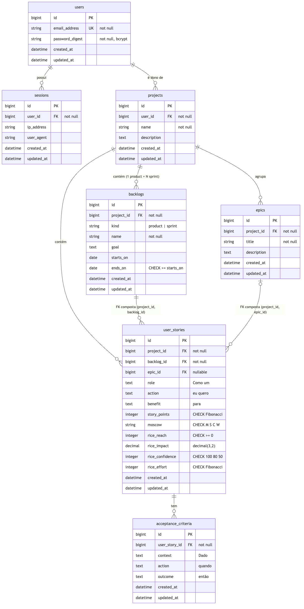

# okonomi — Projeto físico do banco de dados

**Artefato 7** do Trabalho Prático de Engenharia de Software (2026.2): projeto físico
do banco de dados, em diagrama e texto. Rastreado pela issue
[#31](https://github.com/WilsonSousajr/okonomi/issues/31); atende às instruções 19, 20
e 21 e ao Critério de Avaliação 07.

| Versão | Data | Autor | Descrição |
|---|---|---|---|
| 1.0 | 18/10/2026 | José Wilson Barbosa de Sousa Júnior | Versão inicial. |

## 1. Introdução

O okonomi guarda seus dados em um único banco **PostgreSQL 17**. O esquema é criado
pelas *migrations* do Rails e descrito em `db/schema.rb`, que é a fonte deste
documento. Nenhuma tabela é editada à mão.

As regras do domínio ficam no modelo (validações do Active Record) **e**, sempre que
o banco consegue impor, também em restrições do próprio banco. Uma regra que só
existe no formulário não protege os dados: um script, um console ou um defeito na
aplicação passariam por cima dela. Por isso o esquema usa índice único parcial,
chaves estrangeiras compostas, restrições `CHECK` e `decimal` exato. A seção 4
reúne essas restrições.

Convenções usadas em todas as tabelas:

- **Chave primária** `id` do tipo `bigint`, gerada pelo banco.
- **`created_at` e `updated_at`** (`datetime`, não nulos) preenchidos pelo Rails em
  toda inserção e atualização.
- **Chaves estrangeiras** nomeadas `<tabela_no_singular>_id` e sempre indexadas.
- Textos curtos (nomes, e-mail) são `string` (`character varying`); textos livres
  ou longos são `text`.

## 2. Diagrama

O diagrama abaixo identifica as tabelas, suas colunas e os relacionamentos.
`PK` é a chave primária, `FK` a chave estrangeira e `UK` a chave única. A notação
das linhas é a "pé de galinha": `||` lê-se "exatamente um", `o{` "zero ou muitos"
e `|o` "zero ou um".

O fonte do diagrama está em `docs/BANCO-DE-DADOS/der.mmd` (Mermaid), ao lado da
imagem, e pode ser regenerado quando o esquema mudar.

Resumo dos relacionamentos:

| Tabela de origem | Tabela de destino | Cardinalidade | Chave estrangeira | Ao excluir o pai |
|---|---|---|---|---|
| `sessions` | `users` | N : 1 | `user_id` | sessões excluídas |
| `projects` | `users` | N : 1 | `user_id` | projetos excluídos |
| `backlogs` | `projects` | N : 1 | `project_id` | backlogs excluídos |
| `epics` | `projects` | N : 1 | `project_id` | épicos excluídos |
| `user_stories` | `projects` | N : 1 | `project_id` | histórias excluídas |
| `user_stories` | `backlogs` | N : 1 | `(project_id, backlog_id)` | ver seção 4.5 |
| `user_stories` | `epics` | N : 0..1 | `(project_id, epic_id)` | `epic_id` fica nulo |
| `acceptance_criteria` | `user_stories` | N : 1 | `user_story_id` | critérios excluídos |

A coluna "Ao excluir o pai" descreve o comportamento da aplicação (associações
`dependent:` do Rails). No banco, as chaves estrangeiras usam a ação padrão `NO ACTION`, que tem o efeito de `RESTRICT`: ele recusa
apagar um pai que ainda tem filhos, de modo que um registro órfão nunca chega a
existir.

## 3. Tabelas

### 3.1 `users`

**Propósito.** Guarda as contas de usuário. Cada pessoa cria a sua conta
([RF02](https://github.com/WilsonSousajr/okonomi/issues/2)) e é dona dos próprios
projetos. A senha nunca é armazenada: só o seu *digest* bcrypt.

| Coluna | Tipo | Nulo | Descrição |
|---|---|---|---|
| `id` | `bigint` | não | Chave primária. |
| `email_address` | `string` | não | E-mail de acesso, gravado sem espaços nas pontas e em minúsculas. |
| `password_digest` | `string` | não | *Hash* bcrypt da senha (`has_secure_password`). |
| `created_at` | `datetime` | não | Momento da criação. |
| `updated_at` | `datetime` | não | Momento da última alteração. |

- **Chave primária:** `id`.
- **Chaves únicas:** `index_users_on_email_address` em `email_address`. Duas contas
  não podem ter o mesmo e-mail; como o e-mail é normalizado para minúsculas antes de
  gravar, `Ana@x.com` e `ana@x.com` colidem.
- **Relacionamentos:** é referenciada por `sessions.user_id` e `projects.user_id`.

### 3.2 `sessions`

**Propósito.** Registra cada sessão autenticada
([RF03](https://github.com/WilsonSousajr/okonomi/issues/3)). O navegador guarda
apenas o `id` da sessão num cookie assinado, `httponly` e `secure` em produção. Ao
sair, a linha é apagada e o cookie deixa de valer.

| Coluna | Tipo | Nulo | Descrição |
|---|---|---|---|
| `id` | `bigint` | não | Chave primária; é o valor guardado no cookie assinado. |
| `user_id` | `bigint` | não | Dono da sessão. |
| `ip_address` | `string` | sim | IP de origem no momento da entrada. |
| `user_agent` | `string` | sim | Navegador usado na entrada. |
| `created_at` | `datetime` | não | Momento da entrada. |
| `updated_at` | `datetime` | não | Momento da última alteração. |

- **Chave primária:** `id`.
- **Chave estrangeira:** `user_id` → `users.id`.
- **Índices:** `index_sessions_on_user_id`.
- **Relacionamentos:** N sessões para 1 usuário.

### 3.3 `projects`

**Propósito.** Espaço de trabalho de um produto
([RF04](https://github.com/WilsonSousajr/okonomi/issues/4)). Tudo o mais (backlogs,
épicos, histórias) pertence a um projeto, e o projeto pertence a um usuário. Toda
consulta da aplicação parte de `projects.user_id`, e é assim que cada usuário só vê
os próprios dados.

| Coluna | Tipo | Nulo | Descrição |
|---|---|---|---|
| `id` | `bigint` | não | Chave primária. |
| `user_id` | `bigint` | não | Dono do projeto. |
| `name` | `string` | não | Nome do projeto. |
| `description` | `text` | sim | Descrição livre. |
| `created_at` | `datetime` | não | Momento da criação. |
| `updated_at` | `datetime` | não | Momento da última alteração. |

- **Chave primária:** `id`.
- **Chave estrangeira:** `user_id` → `users.id`.
- **Índices:** `index_projects_on_user_id`.
- **Relacionamentos:** N projetos para 1 usuário; 1 projeto para N `backlogs`, N
  `epics` e N `user_stories`.

### 3.4 `backlogs`

**Propósito.** Guarda os dois tipos de backlog de um projeto numa só tabela,
distinguidos por `kind`: o **product backlog**, no máximo um por projeto
([RF05](https://github.com/WilsonSousajr/okonomi/issues/5)), e os **sprint backlogs**,
quantos forem necessários ([RF06](https://github.com/WilsonSousajr/okonomi/issues/6)).
Uma tabela única permite que `user_stories.backlog_id` aponte para qualquer backlog,
e mover uma história entre eles
([RF08](https://github.com/WilsonSousajr/okonomi/issues/8)) é só trocar esse valor.

| Coluna | Tipo | Nulo | Descrição |
|---|---|---|---|
| `id` | `bigint` | não | Chave primária. |
| `project_id` | `bigint` | não | Projeto ao qual o backlog pertence. |
| `kind` | `string` | não | `product` ou `sprint`. |
| `name` | `string` | não | Nome (ex.: "Product backlog", "Sprint 1"). |
| `goal` | `text` | sim | Objetivo do backlog ou da sprint. |
| `starts_on` | `date` | sim | Início da sprint. |
| `ends_on` | `date` | sim | Fim da sprint. |
| `created_at` | `datetime` | não | Momento da criação. |
| `updated_at` | `datetime` | não | Momento da última alteração. |

- **Chave primária:** `id`.
- **Chave estrangeira:** `project_id` → `projects.id`.
- **Chaves únicas:**
  - `index_backlogs_one_product_per_project`: índice único **parcial** em
    `project_id` com `WHERE kind = 'product'`. É o que garante no banco o "no
    máximo um product backlog por projeto" (seção 4.1).
  - `index_backlogs_on_project_id_and_id` em `(project_id, id)`. É o alvo da chave
    estrangeira composta de `user_stories` (seção 4.3).
- **Restrições `CHECK`:**
  - `backlogs_kind_domain`: `kind IN ('product', 'sprint')`.
  - `backlogs_ends_after_start`: `ends_on >= starts_on`.
- **Relacionamentos:** N backlogs para 1 projeto; 1 backlog para N `user_stories`.

### 3.5 `epics`

**Propósito.** Agrupa histórias relacionadas sob um tema maior
([RF10](https://github.com/WilsonSousajr/okonomi/issues/10)). Um épico pertence a um
projeto e só pode receber histórias desse mesmo projeto
([RF11](https://github.com/WilsonSousajr/okonomi/issues/11)).

| Coluna | Tipo | Nulo | Descrição |
|---|---|---|---|
| `id` | `bigint` | não | Chave primária. |
| `project_id` | `bigint` | não | Projeto ao qual o épico pertence. |
| `title` | `string` | não | Título do épico. |
| `description` | `text` | sim | Descrição livre. |
| `created_at` | `datetime` | não | Momento da criação. |
| `updated_at` | `datetime` | não | Momento da última alteração. |

- **Chave primária:** `id`.
- **Chave estrangeira:** `project_id` → `projects.id`.
- **Chaves únicas:** `index_epics_on_project_id_and_id` em `(project_id, id)`, alvo da
  chave estrangeira composta de `user_stories` (seção 4.3).
- **Relacionamentos:** N épicos para 1 projeto; 1 épico para N `user_stories`
  (opcional do lado da história).

### 3.6 `user_stories`

**Propósito.** É o centro do sistema: cada linha é uma história de usuário
([RF07](https://github.com/WilsonSousajr/okonomi/issues/7)) no formato
"Como um [papel] eu quero [ação] para [benefício]"
([RF09](https://github.com/WilsonSousajr/okonomi/issues/9)), com estimativa em story
points ([RF14](https://github.com/WilsonSousajr/okonomi/issues/14),
[RF15](https://github.com/WilsonSousajr/okonomi/issues/15)) e priorização MoSCoW e
RICE ([RF16](https://github.com/WilsonSousajr/okonomi/issues/16) a
[RF19](https://github.com/WilsonSousajr/okonomi/issues/19)).

O formato da história vira **três colunas obrigatórias**, nunca um texto livre. Com
isso é impossível gravar uma história fora do padrão.

| Coluna | Tipo | Nulo | Descrição |
|---|---|---|---|
| `id` | `bigint` | não | Chave primária. |
| `project_id` | `bigint` | não | Projeto da história; ancora as duas chaves compostas. |
| `backlog_id` | `bigint` | não | Backlog em que a história está agora. |
| `epic_id` | `bigint` | sim | Épico ao qual a história está vinculada, se houver. |
| `role` | `text` | não | "Como um …": o papel do usuário. |
| `action` | `text` | não | "eu quero …": a ação desejada. |
| `benefit` | `text` | não | "para …": o benefício esperado. |
| `story_points` | `integer` | sim | Estimativa em story points. |
| `moscow` | `string(1)` | sim | Etiqueta MoSCoW: `M`, `S`, `C` ou `W`. |
| `rice_reach` | `integer` | sim | RICE Reach: número de usuários alcançados. |
| `rice_impact` | `decimal(3,2)` | sim | RICE Impact: 3, 2, 1, 0,5 ou 0,25. |
| `rice_confidence` | `integer` | sim | RICE Confidence, em porcentagem: 100, 80 ou 50. |
| `rice_effort` | `integer` | sim | RICE Effort, na mesma escala dos story points. |
| `created_at` | `datetime` | não | Momento da criação. |
| `updated_at` | `datetime` | não | Momento da última alteração. |

- **Chave primária:** `id`.
- **Chaves estrangeiras:**
  - `project_id` → `projects.id`;
  - `(project_id, backlog_id)` → `backlogs(project_id, id)`, composta;
  - `(project_id, epic_id)` → `epics(project_id, id)`, composta. Quando `epic_id` é
    nulo, a chave não é verificada.
- **Índices:** `index_user_stories_on_project_id`, `index_user_stories_on_backlog_id`,
  `index_user_stories_on_epic_id`.
- **Restrições `CHECK`:**
  - `user_stories_story_points_domain`: `story_points IN (0, 1, 2, 3, 5, 8, 13, 21, 34, 55)`.
  - `user_stories_moscow_domain`: `moscow IN ('M', 'S', 'C', 'W')`.
  - `user_stories_rice_reach_domain`: `rice_reach >= 0`.
  - `user_stories_rice_impact_domain`: `rice_impact IN (3, 2, 1, 0.5, 0.25)`.
  - `user_stories_rice_confidence_domain`: `rice_confidence IN (100, 80, 50)`.
  - `user_stories_rice_effort_domain`: `rice_effort IN (0, 1, 2, 3, 5, 8, 13, 21, 34, 55)`.
- **Relacionamentos:** N histórias para 1 projeto, para 1 backlog e para 0 ou 1
  épico; 1 história para N `acceptance_criteria`.

A pontuação RICE não é armazenada: é calculada pela aplicação a partir das quatro
colunas, pela fórmula `(reach × impact × confidence/100) / effort`
([RF19](https://github.com/WilsonSousajr/okonomi/issues/19)). Guardar só os insumos
evita que a pontuação fique desatualizada quando um deles muda. Com `effort = 0`, a
pontuação fica indefinida e a aplicação mostra "—".

### 3.7 `acceptance_criteria`

**Propósito.** Guarda os critérios de aceitação de cada história
([RF12](https://github.com/WilsonSousajr/okonomi/issues/12)) no formato
"Dado [contexto] quando [ação] então [resultado]"
([RF13](https://github.com/WilsonSousajr/okonomi/issues/13)). Assim como a história,
o formato vira três colunas obrigatórias.

| Coluna | Tipo | Nulo | Descrição |
|---|---|---|---|
| `id` | `bigint` | não | Chave primária. |
| `user_story_id` | `bigint` | não | História à qual o critério pertence. |
| `context` | `text` | não | "Dado …": o estado inicial. |
| `action` | `text` | não | "quando …": a ação ou o evento. |
| `outcome` | `text` | não | "então …": o resultado esperado. |
| `created_at` | `datetime` | não | Momento da criação. |
| `updated_at` | `datetime` | não | Momento da última alteração. |

- **Chave primária:** `id`.
- **Chave estrangeira:** `user_story_id` → `user_stories.id`.
- **Índices:** `index_acceptance_criteria_on_user_story_id`.
- **Relacionamentos:** N critérios para 1 história.

## 4. Restrições de integridade do domínio

### 4.1 Um único product backlog por projeto (#5)

O enunciado diz que "pode existir só um product backlog por projeto". O índice único
parcial `index_backlogs_one_product_per_project` indexa `project_id` **apenas** nas
linhas com `kind = 'product'`. Um segundo product backlog no mesmo projeto viola o
índice. Os sprint backlogs não entram no índice e podem ser quantos forem. O modelo
`Backlog` repete a regra numa validação, para que o usuário receba uma mensagem
clara antes de o banco recusar a gravação. O teste
`a second product backlog in the same project is rejected by the database (#5)`
prova que o banco recusa mesmo quando a validação é contornada.

### 4.2 Escalas fechadas (#15, #16, #18)

Story points e RICE Effort aceitam só a sequência 0, 1, 2, 3, 5, 8, 13, 21, 34 e
55. MoSCoW aceita só M, S, C e W. RICE Impact aceita só 3, 2, 1, 0,5 e 0,25, e RICE
Confidence só 100, 80 e 50. Cada uma dessas escalas é uma restrição `CHECK` (seção
3.6). `rice_impact` é `decimal(3,2)` e não `float`: 0,25 e 0,5 ficam guardados
exatamente, sem erro de arredondamento binário, e a comparação com a escala é exata.

### 4.3 Histórias e épicos não atravessam projetos (#8, #11)

`user_stories` guarda o próprio `project_id`, e as chaves estrangeiras para backlog
e épico são **compostas**: `(project_id, backlog_id)` precisa existir em
`backlogs(project_id, id)`, e `(project_id, epic_id)` em `epics(project_id, id)`. Mover
uma história para o backlog de outro projeto, ou vinculá-la ao épico de outro
projeto, viola a chave estrangeira. Os índices únicos `(project_id, id)` em
`backlogs` e `epics` existem para servir de alvo a essas chaves.

### 4.4 Formatos padrão em colunas (#9, #13)

A história ocupa três colunas `NOT NULL` (`role`, `action`, `benefit`), e o critério
de aceitação também (`context`, `action`, `outcome`). O formato "Como um … eu quero …
para …" e o formato "Dado … quando … então …" são montados pela aplicação a partir
dessas colunas. Não existe campo de texto livre em que um formato diferente possa
ser gravado.

### 4.5 Exclusões em cascata controladas pela aplicação (#4, #6, #7)

- Excluir um **projeto** exclui seus backlogs, épicos, histórias e critérios (#4).
- Excluir uma **história** exclui seus critérios de aceitação (#7).
- Excluir o **product backlog** exclui as histórias que estão nele (#5).
- Excluir um **sprint backlog** não exclui histórias: elas voltam para o product
  backlog do projeto (#6). Se o projeto não tiver product backlog, a exclusão de
  uma sprint com histórias é recusada.
- Excluir um **épico** só desvincula as histórias (`epic_id` fica nulo).

## 5. Rastreabilidade

| Instrução ou item do Critério 07 | Seção |
|---|---|
| Instrução 19: representar o projeto físico por diagrama e texto | 2 e 3 |
| Instrução 20: para cada tabela, nome, colunas, chaves e relacionamentos | 3.1 a 3.7 |
| Instrução 21: para cada tabela, descrição textual do propósito | 3.1 a 3.7 ("Propósito") |
| Projeto físico do banco de dados composto por diagrama e texto | 2 e 3 |
| Fornecido diagrama que identifica tabelas e relacionamentos | 2 |
| Para cada tabela, informado nome, colunas, chaves, relacionamentos etc. | 3.1 a 3.7 |
| Para cada tabela, fornecida descrição textual do propósito | 3.1 a 3.7 |
