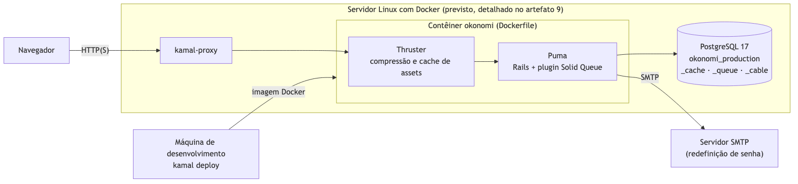

# okonomi — Infraestrutura de implantação

**Artefato 9** do Trabalho Prático de Engenharia de Software (2026.2): descrição da
infraestrutura de implantação, contemplando *hardware*, *software* e serviços.
Rastreado pela issue [#33](https://github.com/WilsonSousajr/okonomi/issues/33);
atende à instrução 25 e ao Critério de Avaliação 09.

| Versão | Data | Autor | Descrição |
|---|---|---|---|
| 1.0 | 02/11/2026 | José Wilson Barbosa de Sousa Júnior | Versão inicial. |
| 1.1 | 04/11/2026 | José Wilson Barbosa de Sousa Júnior | `config/deploy.yml` preenchido conforme este documento; versões atualizadas; procedimento de cópia de segurança detalhado. |

## 1. Introdução

Este documento descreve o que é preciso para pôr o okonomi em produção: os
programas que formam o sistema, a máquina que os executa e os serviços externos
de que ele depende. A arquitetura que justifica essas escolhas está no
[architecture notebook](ARQUITETURA.md) (artefato 5), seção 9.3.

A implantação prevista é deliberadamente simples, coerente com a decisão D1 da
arquitetura (monólito Rails): **um único servidor virtual (VPS) Linux** executa,
em contêineres Docker, a aplicação e o banco de dados. A ferramenta **Kamal**, que
acompanha o Rails 8, constrói a imagem, envia-a para um registro de contêineres e
a coloca no ar no servidor, sem tempo fora do ar entre versões.



## 2. Visão geral

```
Navegador ──HTTPS──▶ kamal-proxy (TLS, Let's Encrypt)
                         │ HTTP
                         ▼
                 Contêiner okonomi
                 Thruster ─▶ Puma ─▶ Rails 8.1
                 (Solid Queue dentro do Puma)
                         │ TCP 5432 (rede interna do Docker)
                         ▼
                 Contêiner PostgreSQL 17
                 okonomi_production, _cache, _queue, _cable
                         │
                         ▼
                 Volume persistente + cópia de segurança diária fora do servidor
```

Uma requisição chega por HTTPS ao **kamal-proxy**, que termina o TLS e repassa a
requisição ao contêiner da aplicação. Dentro dele, o **Thruster** comprime as
respostas e serve os arquivos estáticos, e o **Puma** executa o Rails. Todos os
dados ficam no **PostgreSQL**, inclusive o *cache*, a fila de *jobs* e os canais de
*websocket* (Solid Cache, Solid Queue e Solid Cable), de modo que não há Redis nem
outro serviço de dados para instalar.

## 3. Software

### 3.1 Software do servidor

| Software | Versão | Papel |
|---|---|---|
| Ubuntu Server LTS | 24.04 | Sistema operacional do servidor. Qualquer Linux de 64 bits com Docker serve. |
| Docker Engine | 27 ou superior | Executa os contêineres da aplicação, do banco e do proxy. |
| kamal-proxy | instalado pelo Kamal | Proxy reverso na porta 80/443, TLS automático e troca de versão sem queda. |
| OpenSSH | do sistema | Acesso do Kamal ao servidor para implantar. |
| `ufw` (firewall) | do sistema | Libera só as portas 22, 80 e 443. |

### 3.2 Software da aplicação (imagem Docker)

A imagem é gerada pelo `Dockerfile` do repositório a partir de
`ruby:3.4.10-slim` (Debian). Ela contém (versões conforme o `Gemfile.lock` em
04/11/2026):

| Software | Versão | Papel |
|---|---|---|
| Ruby | 3.4.10 | Linguagem da aplicação, com `jemalloc` para reduzir o uso de memória. |
| Ruby on Rails | 8.1.4 | *Framework* MVC da aplicação. |
| Puma | 8.0.2 | Servidor de aplicação HTTP. |
| Thruster | 0.1.27 | Proxy HTTP/2 na frente do Puma: compressão, *cache* de *assets* e `X-Sendfile`. |
| Solid Queue | 1.7.0 | Fila de *jobs* (e-mail de redefinição de senha), executada dentro do Puma (`SOLID_QUEUE_IN_PUMA`). |
| Solid Cache | 1.0.10 | *Cache* do Rails guardado no PostgreSQL. |
| Solid Cable | 4.1.0 | *Websockets* do Turbo guardados no PostgreSQL. |
| Turbo e Stimulus (Hotwire) | 2.0.23 / 1.3.4 | Interface sem SPA, servida por *importmap* (sem Node.js em produção). |
| Tailwind CSS | 4.3.3 (gem `tailwindcss-ruby`, integrada por `tailwindcss-rails` 4.6.0) | CSS compilado na construção da imagem. |
| `pg` | 1.7.0 | *Driver* do PostgreSQL, com `libpq` e `postgresql-client`. |
| `bcrypt` | 3.1.22 | Hash das senhas. |

### 3.3 Banco de dados

| Software | Versão | Papel |
|---|---|---|
| PostgreSQL | 17 (imagem `postgres:17-alpine`) | Único serviço de dados. Guarda quatro bancos: `okonomi_production` (dados), `okonomi_production_cache`, `okonomi_production_queue` e `okonomi_production_cable`. |

O PostgreSQL roda como **acessório** do Kamal no mesmo servidor (seção `accessories.db`
de `config/deploy.yml`), com os dados num diretório persistente do servidor
(`okonomi-db/data`, montado em `/var/lib/postgresql/data`). Alternativa equivalente: um PostgreSQL gerenciado
(seção 5.2); basta apontar `DATABASE_URL` para ele.

### 3.4 Software da máquina de quem implanta

| Software | Papel |
|---|---|
| Git | Obter o código do repositório. |
| Docker (com *buildx*) | Construir a imagem `linux/amd64`. |
| Ruby 3.4.10 + Bundler | Executar o Kamal (`bin/kamal`, gem 2.12.0). |

## 4. Hardware

O okonomi é um sistema de baixo volume: uma pessoa ou equipe pequena por projeto,
páginas renderizadas no servidor e nenhuma tarefa pesada em segundo plano. Um
único servidor virtual atende com folga.

| Recurso | Mínimo | Recomendado | Justificativa |
|---|---|---|---|
| Arquitetura | x86-64 (amd64) | x86-64 (amd64) | A imagem é construída para `amd64` (`builder.arch` em `config/deploy.yml`). |
| CPU | 1 vCPU | 2 vCPU | Puma com 3 *threads*; o banco divide a máquina com a aplicação. |
| Memória RAM | 2 GB | 4 GB | Rails + Puma usam cerca de 300–500 MB; PostgreSQL, 256 MB a 1 GB; o restante é para o sistema e o *cache* de disco. |
| Disco | 20 GB SSD | 40 GB SSD | Sistema, imagens Docker (algumas versões guardadas para *rollback*) e o banco, que cresce pouco (texto). |
| Rede | IPv4 público, 100 Mbit/s | IPv4 público, 1 Gbit/s | As páginas são HTML leve; a banda só pesa na primeira carga dos *assets*. |
| Armazenamento das cópias de segurança | 10 GB, fora do servidor | 50 GB, fora do servidor | Retenção de 30 cópias diárias do banco compactado (seção 5.6). |

Essas configurações correspondem aos planos de entrada de provedores como
Hetzner Cloud, DigitalOcean ou AWS Lightsail. Quando o uso crescer, o primeiro
passo é mover o PostgreSQL para um servidor ou serviço gerenciado próprio; o
segundo é acrescentar servidores de aplicação na lista `servers.web` do Kamal.

## 5. Serviços

| Serviço | Uso no okonomi | Exemplo de fornecedor |
|---|---|---|
| Hospedagem (VPS) | Executa a aplicação e o banco (seção 4). | Hetzner Cloud, DigitalOcean, AWS Lightsail |
| Banco gerenciado (opcional) | Substitui o PostgreSQL no próprio servidor. | DigitalOcean Managed PostgreSQL, Amazon RDS |
| DNS | Registro `A` do domínio apontando para o IP do servidor. | Registro.br, Cloudflare |
| Certificado TLS | HTTPS obrigatório (`force_ssl`), emitido e renovado automaticamente. | Let's Encrypt, via kamal-proxy |
| Registro de contêineres | Guarda as imagens enviadas pelo Kamal. | GitHub Container Registry (`ghcr.io`), Docker Hub |
| E-mail transacional (SMTP) | Envia o link de redefinição de senha. | Amazon SES, Postmark, Brevo |
| Logs e monitoramento | Lê os *logs* (saída padrão do contêiner) e avisa quando o sistema cai. | `kamal app logs`, UptimeRobot no *health check* `/up` |
| Cópias de segurança | Guarda as cópias diárias do banco fora do servidor. | Armazenamento de objetos compatível com S3 (Backblaze B2, Amazon S3) |
| Integração contínua | Roda RuboCop, Brakeman, bundler-audit, auditoria do *importmap* e todos os testes antes de cada *merge*. | GitHub Actions (já configurado) |

### 5.1 DNS e TLS

O domínio (por exemplo, `okonomi.exemplo.com.br`) recebe um registro `A` com o IP
do servidor. Em `config/deploy.yml`, a seção `proxy` declara esse domínio com
`ssl: true` (o arquivo traz um domínio e um IP de exemplo, que são trocados pelos
reais no passo 3 da seção 6); o kamal-proxy obtém o certificado do Let's Encrypt na primeira
implantação e o renova sozinho. Como a aplicação usa `assume_ssl` e `force_ssl`,
todo acesso HTTP é redirecionado para HTTPS e o *cookie* de sessão só trafega
cifrado (#40).

### 5.2 Banco de dados

O PostgreSQL é declarado como o acessório `db` do Kamal (imagem
`postgres:17-alpine`, usuário `okonomi`), com a senha em `.kamal/secrets` e os
dados no diretório `okonomi-db/data` do servidor. A aplicação alcança o banco pelo
nome `okonomi-db` na rede interna do Docker e recebe `DATABASE_URL` sem nome de
banco: os nomes dos quatro bancos vêm de `config/database.yml`. Os bancos são
criados e migrados por `bin/rails db:prepare`, executado pelo
`bin/docker-entrypoint` a cada início de contêiner. A porta 5432 só é publicada
na interface local do servidor (`127.0.0.1`), nunca para a internet.

### 5.3 E-mail

A única mensagem enviada é a de redefinição de senha (#3), entregue por
Solid Queue. Em produção (`config/environments/production.rb`),
`config.action_mailer.smtp_settings` aponta para o servidor SMTP da variável
`SMTP_ADDRESS`, na porta 587 com STARTTLS obrigatório (`enable_starttls`), com usuário e senha guardados nas *credentials* do
Rails (`smtp.user_name` e `smtp.password`); `default_url_options` usa o domínio da
variável `APP_HOST`, para que o link do e-mail aponte para o site real. As duas
variáveis são declaradas em `env.clear` de `config/deploy.yml`.

### 5.4 Segredos

Nenhum segredo fica no repositório. O Kamal lê de `.kamal/secrets`, na máquina de
quem implanta:

| Segredo | Uso |
|---|---|
| `RAILS_MASTER_KEY` | Decifra `config/credentials.yml.enc` (SMTP e `secret_key_base`). |
| `KAMAL_REGISTRY_PASSWORD` | Token de acesso ao registro de contêineres. |
| `POSTGRES_PASSWORD` | Senha do PostgreSQL, usada pelo acessório. |
| `DATABASE_URL` | Montada em `.kamal/secrets` a partir de `POSTGRES_PASSWORD` (`postgres://okonomi:…@okonomi-db:5432`). |

`.kamal/secrets` só referencia variáveis de ambiente e arquivos locais
(`config/master.key`); nenhum valor é escrito nele, e por isso ele pode ser
versionado.

### 5.5 Logs e monitoramento

O Rails escreve os *logs* na saída padrão (`config.logger` em
`production.rb`), com nível ajustável por `RAILS_LOG_LEVEL`. Eles são lidos com
`bin/kamal logs` (alias definido em `config/deploy.yml`). O Rails expõe `/up`,
que responde 200 quando a aplicação sobe sem erro; o kamal-proxy usa esse
endereço antes de trocar de versão, e um monitor externo pode consultá-lo a cada
minuto.

### 5.6 Cópia de segurança e restauração

- **Diária:** uma tarefa `cron` do usuário `root` no servidor, criada no passo 6
  do procedimento de implantação, gera a cópia às 3h e a envia ao armazenamento
  de objetos (com a ferramenta `rclone`, configurada para o *bucket*):

  ```
  0 3 * * * docker exec okonomi-db pg_dump -U okonomi --format=custom okonomi_production > /root/backup/okonomi-$(date +\%F).dump && rclone copy /root/backup remoto:okonomi-backup && find /root/backup -name '*.dump' -mtime +1 -delete
  ```

  O formato `custom` já é compactado. Os bancos de *cache*, fila e canais são
  descartáveis e não entram na cópia.
- **Retenção:** 30 cópias diárias, aplicada por uma regra de ciclo de vida do
  *bucket* que apaga objetos com mais de 30 dias.
- **Restauração:** `pg_restore --clean --dbname=okonomi_production` a partir da
  cópia escolhida, com a aplicação parada (`bin/kamal app stop`). A restauração é
  testada a cada mudança de versão do PostgreSQL.

## 6. Procedimento de implantação

1. Contratar o servidor (seção 4), instalar Docker e liberar as portas 22, 80 e 443.
2. Criar o registro `A` do domínio (seção 5.1).
3. Em `config/deploy.yml`, trocar os valores de exemplo pelos reais: IP do
   servidor em `servers.web` e `accessories.db.host`, domínio em `proxy.host` e
   `APP_HOST`, servidor SMTP em `SMTP_ADDRESS`. O registro (`ghcr.io`) e o
   acessório `db` com `postgres:17-alpine` já estão declarados.
4. Preencher `.kamal/secrets` com os segredos da seção 5.4.
5. Executar `bin/kamal setup`: instala o kamal-proxy, sobe o PostgreSQL, constrói
   e envia a imagem e inicia a aplicação.
6. Verificar `https://<domínio>/up`, criar a primeira conta pela interface e
   instalar no servidor o `rclone` e a tarefa `cron` de cópia de segurança
   (seção 5.6).
7. Nas versões seguintes, `bin/kamal deploy` (troca sem queda) e, se preciso,
   `bin/kamal rollback <versão>`.

## 7. Rastreabilidade

| Instrução ou item do Critério 09 | Seção |
|---|---|
| Instrução 25: descrever *hardware*, *software* e serviços para pôr o sistema em produção | 3, 4 e 5 |
| Provida informação sobre *software* necessário à implantação | 3 |
| Provida informação sobre *hardware* necessário à implantação | 4 |
| Provida informação sobre serviços necessários à implantação | 5 |
