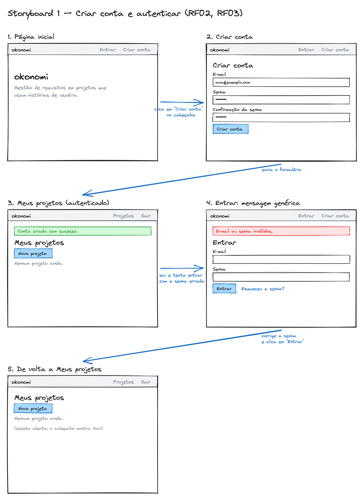
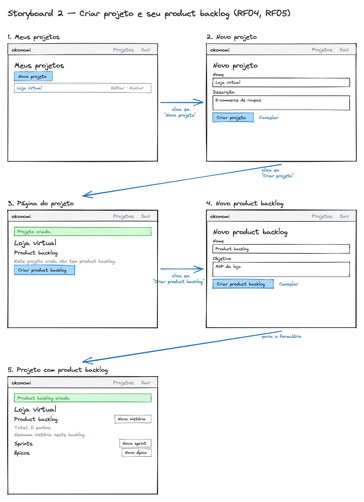
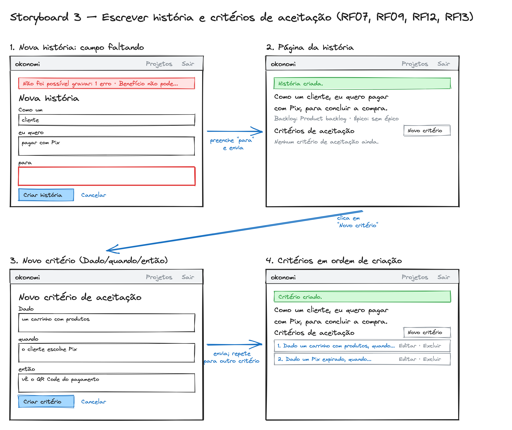
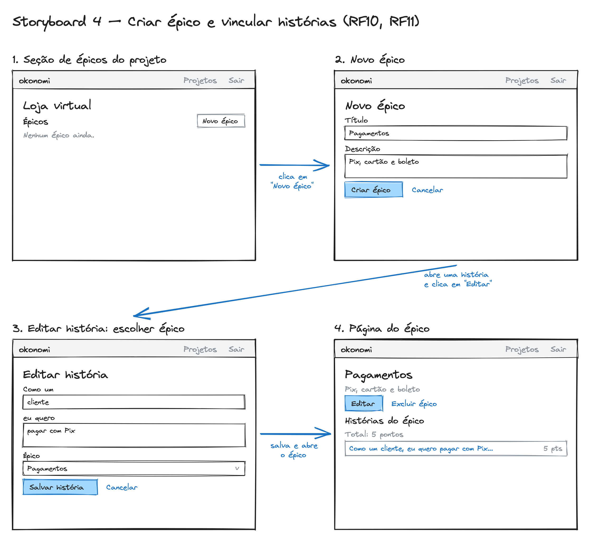
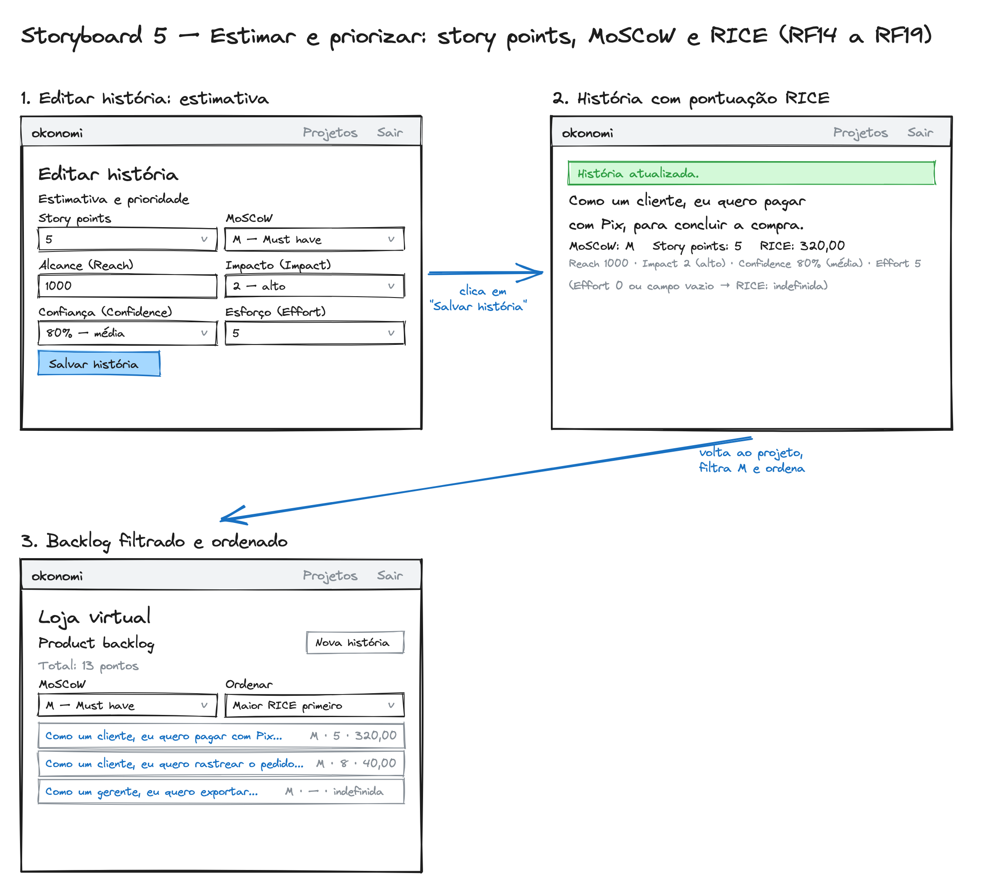
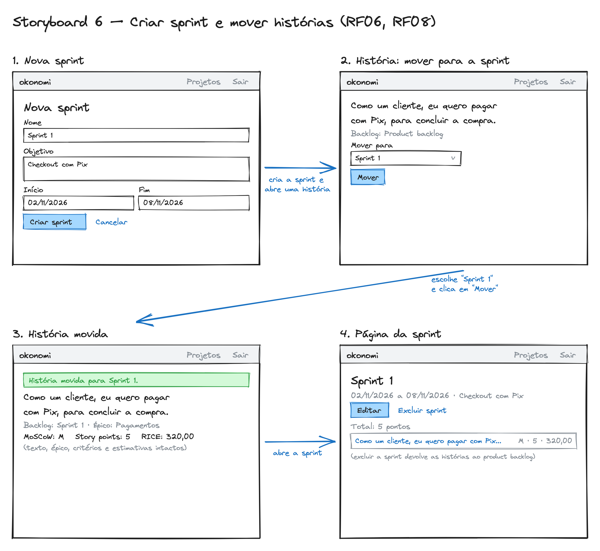

# okonomi — Projeto de interface com o usuário

**Artefato 6** do Trabalho Prático de Engenharia de Software (2026.2): projeto de
interface com o usuário, em *storyboards* compostos por *wireframes*. Rastreado pela
issue [#30](https://github.com/WilsonSousajr/okonomi/issues/30); atende às instruções
17 e 18 e ao Critério de Avaliação 06.

| Versão | Data | Autor | Descrição |
|---|---|---|---|
| 1.0 | 28/10/2026 | José Wilson Barbosa de Sousa Júnior | Versão inicial. |

## 1. Introdução

Cada *storyboard* descreve um cenário de uso do okonomi como uma sequência numerada
de *wireframes*. Cada *wireframe* é um esboço simples de uma tela: só a estrutura,
os rótulos e os botões. Não há cores finais nem tipografia.

**Como ler os storyboards**

- Os quadros são numerados na ordem em que o usuário passa por eles.
- A seta azul liga um quadro ao próximo, e o texto junto dela diz o que o usuário
  faz para chegar lá (clica, preenche, envia).
- Dentro de cada quadro:
  - a faixa cinza no topo é o cabeçalho, com o nome *okonomi* à esquerda e a
    navegação à direita ("Entrar · Criar conta" para visitantes, "Projetos · Sair"
    para quem está autenticado);
  - os retângulos com rótulo em cima são campos de formulário;
  - um "v" à direita indica uma lista de seleção;
  - o retângulo azul preenchido é o botão principal, e o texto azul ao lado é um
    link secundário;
  - a faixa verde é uma mensagem de sucesso e a vermelha, uma mensagem de erro;
  - a borda vermelha marca o campo que tem erro;
  - o texto entre parênteses é uma anotação do esboço, não aparece na tela.

Os rótulos e as mensagens dos esboços são os mesmos da aplicação, para que o
protótipo (artefato 8, [#32](https://github.com/WilsonSousajr/okonomi/issues/32))
siga este projeto. Os arquivos-fonte `.excalidraw` estão em
[`docs/INTERFACE/`](INTERFACE/) e podem ser abertos e editados em
[excalidraw.com](https://excalidraw.com).

**Ator:** em todos os cenários, o usuário é alguém da equipe de produto (*product
owner*, *scrum master* ou desenvolvedor), como descrito no
[documento de visão](VISAO.md).

## 2. Storyboards

### 2.1 Criar conta e autenticar (RF02, RF03)

**Cenário.** Ana ainda não tem conta. Ela se cadastra e cai direto na sua lista de
projetos. Depois sai, tenta entrar com a senha errada e recebe uma mensagem genérica,
que não diz se o e-mail existe. Por fim corrige a senha e entra.

1. **Página inicial:** um visitante vê o nome do produto e os links *Entrar* e
   *Criar conta* no cabeçalho.
2. **Criar conta:** e-mail, senha e confirmação da senha.
3. **Meus projetos:** a conta é criada, a sessão já começa e o cabeçalho passa a
   mostrar *Sair*.
4. **Entrar com erro:** a mensagem "E-mail ou senha inválidos." é a mesma para
   e-mail desconhecido e para senha errada.
5. **De volta a Meus projetos,** já autenticada.

### 2.2 Criar projeto e seu product backlog (RF04, RF05)

**Cenário.** Ana cria o projeto "Loja virtual". O projeto ainda não tem product
backlog, então a página oferece criá-lo. Depois de criado, a página do projeto mostra
o product backlog, as sprints e os épicos.

1. **Meus projetos,** com o botão *Novo projeto*.
2. **Novo projeto:** nome e descrição.
3. **Página do projeto sem product backlog,** com o botão *Criar product backlog*.
4. **Novo product backlog:** nome e objetivo.
5. **Projeto com product backlog,** ainda sem histórias. Um projeto só pode ter um
   product backlog, então a opção de criar outro não aparece mais.

### 2.3 Escrever história e critérios de aceitação (RF07, RF09, RF12, RF13)

**Cenário.** Ana escreve uma história no formato *Como um … eu quero … para …*,
esquece o benefício e vê o campo apontado. Depois de corrigir, a história nasce no
product backlog, e ela acrescenta critérios no formato *Dado … quando … então …*.

1. **Nova história com um campo faltando:** a mensagem de erro aparece no topo e o
   campo "para" fica com borda vermelha.
2. **Página da história:** o texto completo no formato padrão, o backlog e o épico.
3. **Novo critério de aceitação:** três campos rotulados *Dado*, *quando* e *então*.
4. **Critérios listados na ordem em que foram criados,** cada um com *Editar* e
   *Excluir*.

### 2.4 Criar épico e vincular histórias (RF10, RF11)

**Cenário.** Ana cria o épico "Pagamentos" e vincula a ele a história do Pix. A
página do épico mostra as histórias vinculadas e a soma dos seus story points.

1. **Seção de épicos** na página do projeto.
2. **Novo épico:** título e descrição.
3. **Editar história:** o campo *Épico* lista só os épicos do projeto, mais a opção
   "Sem épico".
4. **Página do épico:** as histórias vinculadas e o total de pontos.

### 2.5 Estimar e priorizar: story points, MoSCoW e RICE (RF14 a RF19)

**Cenário.** Ana estima a história em 5 pontos, etiqueta como *Must have* e preenche
o RICE (Reach 1000, Impact 2, Confidence 80%, Effort 5). A pontuação calculada é
320. Depois ela filtra o backlog pelas histórias *M* e ordena pela maior pontuação.

1. **Editar história, grupo "Estimativa e prioridade":** as listas oferecem só os
   valores permitidos, com o rótulo do método ("2 — alto", "80% — média",
   "M — Must have").
2. **História com a pontuação calculada:** (1000 × 2 × 0,8) / 5 = 320,00. Se algum
   campo ficar vazio, ou se Effort for 0, a pontuação aparece como "indefinida".
3. **Backlog filtrado por MoSCoW e ordenado por RICE:** as pontuações indefinidas
   ficam no fim da lista.

### 2.6 Criar sprint e mover histórias para a sprint (RF06, RF08)

**Cenário.** Ana planeja a "Sprint 1" e move a história do Pix do product backlog
para ela. A história chega à sprint sem perder o texto, o épico, os critérios nem as
estimativas.

1. **Nova sprint:** nome, objetivo, início e fim.
2. **Página da história:** a lista *Mover para* mostra só os outros backlogs do mesmo
   projeto.
3. **História movida:** a mensagem confirma a sprint de destino, e os dados da
   história continuam os mesmos.
4. **Página da sprint:** as histórias da sprint e o total de pontos.

## 3. Roteiro do vídeo de teste de sistema

O vídeo do artefato 8 (instrução 24) mostra um cenário de sucesso para cada serviço
do sistema. Os cenários são os mesmos destes storyboards, na mesma ordem:

| Trecho do vídeo | Storyboard | Requisitos |
|---|---|---|
| 1. Criar conta, sair, errar a senha, entrar | 2.1 | RF01, RF02, RF03 |
| 2. Criar projeto e product backlog | 2.2 | RF04, RF05 |
| 3. Escrever história e critérios | 2.3 | RF07, RF09, RF12, RF13 |
| 4. Criar épico e vincular a história | 2.4 | RF10, RF11 |
| 5. Estimar, etiquetar, calcular RICE, filtrar e ordenar | 2.5 | RF14 a RF19 |
| 6. Criar sprint e mover a história | 2.6 | RF06, RF08 |

## 4. Rastreabilidade

| Instrução ou item do Critério 06 | Seção |
|---|---|
| Instrução 17: projeto de interface por *storyboards* compostos por *wireframes* | 2 |
| Instrução 18: cada *wireframe* é um esboço simples de tela | 1 ("Como ler") e 2.1 a 2.6 |
| Projeto de interface composto por *storyboards* | 2 |
| Cada *storyboard* descreve um cenário de uso | 2.1 a 2.6 ("Cenário") |
| Cada *storyboard* é composto por uma sequência de *wireframes* | 2.1 a 2.6 (quadros numerados) |
| Cada *wireframe* é um esboço simples de tela | 2.1 a 2.6 (imagens) |
